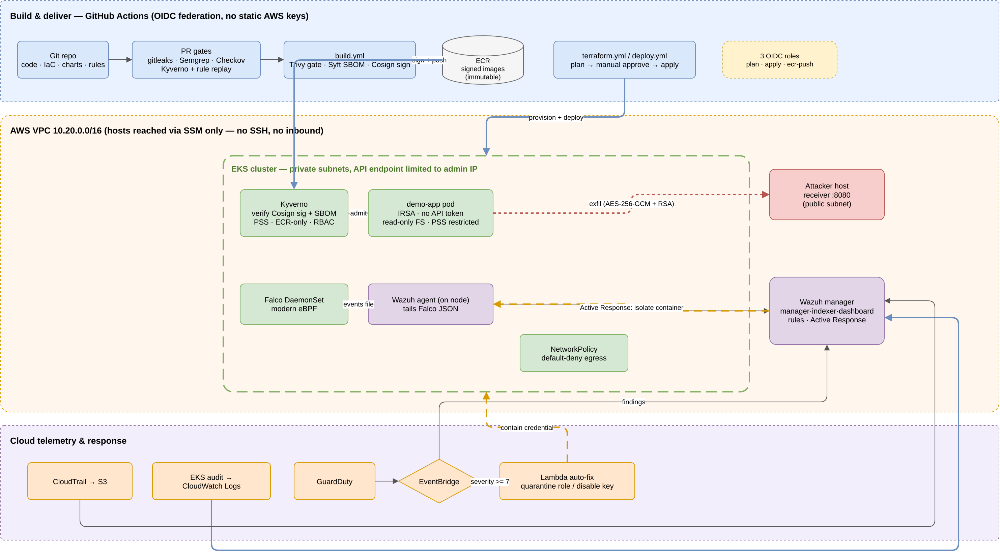

# CipherGuard v2.0

Secure container pipeline with Kubernetes runtime detection (EKS + Kyverno + Falco + Wazuh).
Region: `ap-southeast-1` (Singapore). Pod access to AWS: IRSA.

Docs:
- [docs/project-report.md](docs/project-report.md): full project report (Vietnamese)
- [docs/scenarios-guide.md](docs/scenarios-guide.md): how to run each attack scenario and what Wazuh should show (Vietnamese)
- [docs/attack-scenarios.md](docs/attack-scenarios.md): scenario catalogue and MITRE mapping

## Architecture



Source: [docs/diagram/cipherguard-architecture.drawio](docs/diagram/cipherguard-architecture.drawio) (open in [draw.io](https://app.diagrams.net)); regenerate with `docs/diagram/gen-diagram.py` + `rlespinasse/drawio-export`.

## Layout

```
infra/bootstrap/   persistent: S3 state, DynamoDB lock, budget, ECR, GitHub OIDC roles
infra/terraform/   the lab: VPC, EKS, Wazuh, attacker host, IRSA role (destroyed every session)
app/               demo application (attack target)
charts/demo-app/   Helm chart: digest-only image, IRSA, no API token, PSS restricted, NetworkPolicy, RBAC
charts/cluster-policies/  Kyverno 1.20 CEL policies (signatures, registries, PSS, RBAC guardrail)
platform/          namespaces (native PSA), Kyverno and Falco chart values
detection/         Falco rules, Wazuh rules (incl. GuardDuty), agent config, AWS module, Active Response
.github/workflows/ security (scanners + negative tests), build (Trivy, push, SBOM, Cosign), terraform
scripts/scan.sh    all scanners in pinned containers; CI and local use the same script
tests/negative/    deliberately insecure fixtures the pipeline must block
tests/policies/    Kyverno CLI test suite (attack fixtures must be rejected)
tests/detection/   sample events replayed through wazuh-analysisd (expected rule IDs)
attack/            exfil.py (AES-256-GCM+RSA), run-attack.sh chain runner, receiver, lab RSA public key
docs/              scenarios and notes
```

## One-time setup

```bash
cd infra/bootstrap
echo 'budget_alert_email = "you@example.com"' > terraform.tfvars
cd ../.. && make bootstrap        # also writes infra/terraform/backend.hcl
```

Then configure GitHub (variables, `lab` environment, branch protection): [docs/github-setup.md](docs/github-setup.md).
The lab can be created locally (`make up`) or from Actions > terraform > Run workflow.

## Each session

```bash
cp infra/terraform/terraform.tfvars.example infra/terraform/terraform.tfvars   # first time only
# set admin_cidr to your current IP: curl -s https://checkip.amazonaws.com

make up           # create lab (~15-20 min, mostly EKS) and update kubeconfig
kubectl get nodes

# Wazuh dashboard (install takes ~10 min after the instance boots)
terraform -chdir=infra/terraform output -raw wazuh_admin_password_command | bash
terraform -chdir=infra/terraform output -raw wazuh_dashboard_tunnel | bash
# open https://localhost:8443, user: admin

make deploy       # Kyverno + policies (Enforce) + demo app, then smoke test
make deploy-detect  # detect-only run: policies Audit, egress open

make down         # destroy everything, then list leftovers
```

Access to the Wazuh and attacker hosts is through SSM Session Manager only (no SSH, no public ports).
This needs the [Session Manager plugin](https://docs.aws.amazon.com/systems-manager/latest/userguide/session-manager-working-with-install-plugin.html).

## Pipeline gates (phase 3)

| Gate | Tool | Fails on |
|---|---|---|
| Secrets | gitleaks (full history) | any detected secret |
| Dockerfile | hadolint | warnings and above (e.g. `USER root`) |
| SAST | Semgrep (Python, Dockerfile, Actions) | any finding (e.g. unpinned action, script injection) |
| IaC | Checkov (Terraform, Dockerfile, Actions, K8s/Helm) | any failed check without an inline justified skip |
| Image | Trivy | fixable HIGH/CRITICAL CVEs |
| Supply chain | Syft + Cosign keyless | main only: SBOM attested, image signed by `build.yml@refs/heads/main` |

`make scan`, `make scan-image` and `make negative` run the same checks locally (Docker required).
Exceptions are written inline as `#checkov:skip=<ID>:<reason>` so they show up in review.

## Cluster hardening (phase 4)

| Control | Where | Attack step |
|---|---|---|
| Only images signed by `build.yml@main` with an SBOM attestation | `ImageValidatingPolicy` | 0, H |
| App namespaces pull only from the lab ECR repo | `ValidatingPolicy` | 0 |
| PSS restricted in `demo`, baseline everywhere else (no privileged, hostPath, hostPID) | `ValidatingPolicy` + native PSA | 3, B |
| No cluster-admin for ServiceAccounts | `ValidatingPolicy` | 3 |
| No Kubernetes API token in the pod; IRSA role limited to its own SSM path | chart + Terraform | 2, 3, I |
| IMDS unreachable from pods (hop limit 1 + NetworkPolicy) | Terraform + chart | D |
| Default-deny NetworkPolicy; egress only DNS and 443 outside the VPC | chart | 4, F |
| Developers: read-only, no `exec`, no secrets | chart RBAC | 1, E |

`--mode detect` switches every policy to Audit and opens egress for the detect-only run.

## Runtime detection (phase 5)

GuardDuty findings reach Wazuh via EventBridge -> CloudWatch Logs, and high-severity ones trigger a Lambda
that quarantines the abused lab role (Deny-all inline policy) or disables a leaked access key.

Falco (modern eBPF) writes JSON events on each node; the Wazuh agent ships them. EKS audit logs reach
Wazuh through CloudWatch Logs, CloudTrail through S3. Rules are MITRE-mapped and replayed in a real
`wazuh-analysisd` in CI (`scripts/scan.sh detection`). `scripts/wazuh-sync.sh` pushes them to the
manager over SSM, validates, and rolls back on error. `make deploy` runs both automatically.

## Commits

Commit messages follow `[NAMESPACE] Description` (see [.claude/skills/commit/SKILL.md](.claude/skills/commit/SKILL.md)).
Enable the hooks once per clone: `git config core.hooksPath .githooks`.

## Cost notes

Billed per hour while the lab is up: EKS control plane, 2 x t3.large nodes, t3.large Wazuh, NAT Gateway.
Always run `make down` at the end. The state bucket, lock table and budget are kept.
