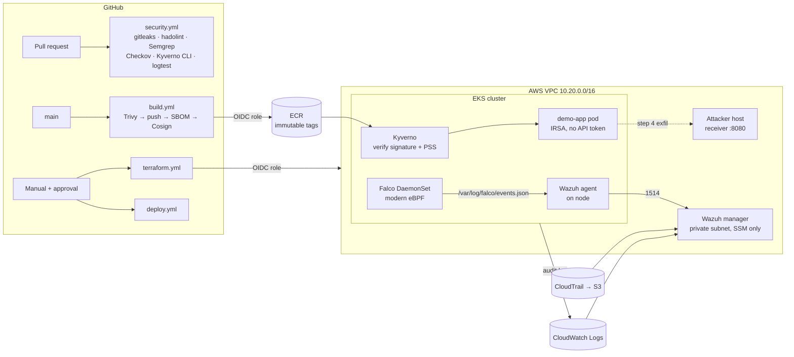

# Báo cáo dự án CipherGuard v2.0

**Secure Container Pipeline with Kubernetes Runtime Detection**
Cập nhật: 19/11/2026 · Trạng thái: đã code xong Phase 1–6, Phase 7 chưa làm

## 1. Tóm tắt

CipherGuard v2.0 là một lab DevSecOps. Mục tiêu là chứng minh bảo mật được áp dụng ở cả bốn giai đoạn của một workload container: viết code, build, deploy và vận hành. Lab chạy trên AWS (Singapore, `ap-southeast-1`) và được tạo hoàn toàn từ code.

| Giai đoạn | Làm gì | Công cụ |
|---|---|---|
| Code | Hạ tầng, chart, policy và rule phát hiện đều nằm trong Git và được scan trên mỗi PR | Terraform, Helm, gitleaks, Semgrep, Checkov |
| Build | Build image, scan lỗ hổng, tạo SBOM, ký image. Không có AWS key nào tồn tại | GitHub Actions + OIDC, Trivy, Syft, Cosign keyless |
| Deploy | Cluster chỉ chạy image đã ký, áp Pod Security, NetworkPolicy default-deny, RBAC tối thiểu | EKS, Kyverno 1.20, IRSA |
| Vận hành | Phát hiện hành vi tấn công trong container và trên API, gửi về SIEM | Falco 0.45, Wazuh 4.14, EKS audit log, CloudTrail |

Điểm khác biệt giữ lại từ v1.0 là bước exfiltration dữ liệu được mã hóa lai (AES-256-GCM + RSA). Mục đích là chứng minh vẫn phát hiện được bằng hành vi khi không thể đọc được nội dung.

**Kết quả hiện tại.** Tất cả kiểm tra offline đều xanh:
- 5 gate scan;
- 5 negative test chứng minh các gate chặn được thay đổi xấu;
- 10 test policy Kyverno;
- 26 case phát hiện chạy qua `wazuh-analysisd` thật.

Chưa có gì được chạy trên EKS thật. Phase 4 và Phase 5 chỉ được xác nhận hoàn tất khi chạy `make up`, `make deploy` và đo trên lab.

## 2. Kiến trúc



Toàn bộ code nằm trong các thư mục sau.

| Thư mục | Nội dung |
|---|---|
| `infra/bootstrap/` | Tài nguyên giữ lại lâu dài: S3 state, DynamoDB lock, budget, ECR, OIDC provider và 3 role cho GitHub |
| `infra/terraform/` | Lab, xóa sau mỗi session: VPC, EKS, Wazuh, attacker host, IRSA, CloudTrail |
| `app/` | Demo app, cũng là mục tiêu tấn công |
| `charts/` | Chart `demo-app` và `cluster-policies` |
| `platform/` | Namespace và values cho Kyverno, Falco |
| `detection/` | Rule Falco, rule Wazuh, agent.conf, cấu hình module AWS |
| `scripts/` | `scan.sh`, `deploy.sh`, `smoke.sh`, `wazuh-sync.sh` |
| `tests/` | Fixture negative, test policy, case phát hiện |
| `.github/workflows/` | `security`, `build`, `terraform`, `deploy` |

## 3. Chi tiết từng phase

### Phase 1: Hạ tầng bằng code

**Đã làm.** Có hai stack Terraform:
- **Bootstrap:** chạy một lần, dùng state local.
- **Lab:** tạo và xóa theo từng session.

Lab gồm:
- VPC 2 AZ với 1 NAT Gateway;
- EKS dùng node AL2023, chỉ mở API endpoint cho IP của bạn, audit log đẩy sang CloudWatch, secrets mã hóa bằng KMS;
- Wazuh all-in-one và attacker host.

**Quyết định thiết kế:**
- **Không SSH, không mở cổng ra internet.** Wazuh và attacker host chỉ truy cập qua SSM Session Manager. Dashboard mở bằng port-forward. Cách này chặt hơn proposal, vốn mở cổng 443 và 22 cho IP của bạn.
- **IMDSv2 với hop limit 1.** Pod không lấy được credential của node. Đây là phần phòng thủ cho scenario D.
- **Budget và ECR đặt trong bootstrap.** Chúng không bị xóa theo lab, nên image và chữ ký vẫn còn sau mỗi session.
- **Access entry tường minh.** Cả người chạy apply lẫn pipeline role đều là admin cluster, không phụ thuộc ai là người tạo cluster.

**Kiểm chứng:** `terraform validate` pass cho cả hai stack, và Checkov không còn lỗi nào. Mọi ngoại lệ đều được ghi lý do ngay tại resource.

### Phase 2: Pipeline an toàn

**Đã làm:**
- OIDC provider cho GitHub và 3 role, mỗi role chỉ tin đúng một `sub` claim:
  - `gha-plan`: dùng cho PR và main, chỉ đọc;
  - `gha-apply`: chỉ dùng được từ environment `lab`, tức bắt buộc có người duyệt;
  - `gha-ecr-push`: chỉ dùng từ main, chỉ push được vào một repo.
- Apply chạy thủ công. Plan được tạo ra và hiển thị trước, người duyệt xem rồi mới apply đúng plan đó.

**Quyết định thiết kế:** role apply dùng `PowerUserAccess`, cộng thêm quyền IAM giới hạn ở các resource tên `cipherguard-*`. Có thêm các lệnh deny tường minh để role không sửa được chính các role của pipeline và không gắn được policy admin.

**Rủi ro còn lại:** `PowerUserAccess` vẫn rộng. Muốn thu hẹp thì cần chạy lab thật để biết chính xác những quyền nào được dùng.

### Phase 3: Scan sớm và ký image

**Đã làm:** gom mọi scanner vào [scripts/scan.sh](../scripts/scan.sh), chạy bằng container đã pin version. CI và máy local cho ra kết quả giống nhau.

| Gate | Fail khi |
|---|---|
| gitleaks | Có secret trong toàn bộ lịch sử Git |
| hadolint | Có cảnh báo trở lên, ví dụ `USER root` |
| Semgrep | Có finding bất kỳ, ví dụ action chưa pin, script injection |
| Checkov | Có check fail mà không kèm skip có lý do |
| Trivy | Có CVE HIGH hoặc CRITICAL đã có bản vá |

Trên main, workflow push image theo digest, attest SBOM SPDX, ký Cosign keyless, rồi tự chạy `cosign verify` bằng đúng identity mà Kyverno sẽ kiểm tra.

**Negative test.** Job `negative` đưa vào các thay đổi cố tình sai và yêu cầu mỗi scanner phải chặn:
- một AWS key được sinh ngẫu nhiên lúc chạy;
- Dockerfile chạy root;
- S3 bucket public;
- image `alpine:3.10` có lỗ hổng.

Chính job này đã phát hiện `.checkov.yaml` làm Checkov bỏ qua thư mục fixture.

**Lỗi thật mà scanner đã bắt:**
- CVE HIGH trong urllib3, pip, setuptools, msgpack và zlib của image;
- script injection qua `${{ inputs.* }}` trong workflow (xảy ra hai lần);
- tất cả action được pin theo commit SHA.

### Phase 4: Deploy và hardening cluster

**Đã làm:**
- **Chart `demo-app`:**
  - image chỉ deploy theo digest;
  - không mount token Kubernetes, nhưng IRSA vẫn hoạt động;
  - read-only root FS, drop ALL capabilities, uid 10001;
  - NetworkPolicy default-deny với hai chế độ `enforce` và `open`;
  - role developer chỉ đọc.
- **Chart `cluster-policies`:**

| Policy | Chặn | Bước |
|---|---|---|
| `verify-image-signatures` (ImageValidatingPolicy) | Image không có chữ ký hoặc SBOM từ `build.yml@main` | 0, H |
| `restrict-image-registries` | Image không lấy từ ECR của lab | 0 |
| `pod-security-baseline` | Privileged, hostPath, hostPID/IPC/Network, hostPort, capability ngoài danh sách | 3, B |
| `pod-security-restricted` | Chạy root, cho phép leo quyền, không drop ALL, thiếu seccomp, volume không được phép | 3 |
| `deny-cluster-admin-to-serviceaccounts` | Gán cluster-admin cho ServiceAccount | 3 |

Một giá trị `mode` duy nhất chuyển toàn bộ policy giữa Enforce và Audit, phục vụ hai lượt prevent và detect-only.

**Phát hiện quan trọng:**
- **Kyverno 1.20 không còn chạy `ClusterPolicy` kiểu cũ.** Toàn bộ policy được viết lại theo API `policies.kyverno.io/v1`, validation bằng CEL. Nếu không có test bằng Kyverno CLI, policy sẽ bị từ chối ngay khi deploy.
- **Pattern registry `repo*` để lọt cả `demo-app-evil`.** Giờ ngay sau tên repo bắt buộc là `@` hoặc `:`.
- **Kyverno cần IRSA riêng để đọc chữ ký trong ECR,** vì hop limit 1 khiến pod không dùng được node role.
- **Checkov âm thầm bỏ qua Helm chart** vì chart cần giá trị bắt buộc. Giờ chart được render ra trước rồi mới scan.

**Kiểm chứng:** Kyverno CLI pass 10/10 test (chart thật pass, các fixture tấn công bị từ chối). Checkov trên chart đã render pass 103/103 check. Smoke test (`scripts/smoke.sh`) kiểm tra IRSA, xác nhận không có key tĩnh, và gửi các yêu cầu xấu bằng dry-run phía server để xem Kyverno có từ chối không. Smoke test này chỉ chạy được trên lab thật.

### Phase 5: Phát hiện lúc runtime

**Đã làm.** Dữ liệu đi vào Wazuh theo ba đường:
1. **Falco:** chạy modern eBPF, ghi event JSON ra `/var/log/falco/events.json` trên node. Wazuh agent cài trong user data của node đọc file đó, theo agent.conf của group `eks-nodes`.
2. **EKS audit log:** đi qua CloudWatch Logs. Module AWS của Wazuh poll mỗi 30 giây.
3. **CloudTrail:** ghi vào S3. Wazuh đọc từ bucket này.

Ngoài ra:
- Có 10 rule Falco riêng và 25 rule Wazuh riêng (15 cho Falco, 8 cho EKS audit, 2 cho CloudTrail). Mọi rule phát hiện đều map một kỹ thuật MITRE; vài rule nền dùng để phân loại event thì không. Bảng tra nằm trong [scenarios-guide.md](scenarios-guide.md#4-bảng-tra-rule).
- Rule tương quan **100130** báo khi cùng một container vừa đọc dữ liệu vừa mở kết nối ra ngoài trong vòng 2 phút.
- [scripts/wazuh-sync.sh](../scripts/wazuh-sync.sh) đẩy rule lên manager qua SSM Run Command. Trên manager, `apply.sh` kiểm tra config, chỉ restart khi config hợp lệ, và tự rollback nếu sai.

**Kiểm chứng offline:**
- `falco -V` xác nhận rule load được cùng bộ rule mặc định, không có warning.
- 26 event mẫu (Falco, EKS audit, CloudTrail, agent mất kết nối) được chạy qua `wazuh-analysisd` 4.14.10 thật. Cả 26 khớp đúng rule ID và MITRE, kể cả các trường hợp lành tính không được báo động.
- `verify-agent-conf` và `wazuh-modulesd -t` chấp nhận cấu hình.

**Lỗi bộ test đã bắt:**
- **Request bị 403 khi list secrets lại khớp rule "secrets bị đọc".** Đã thêm điều kiện status phải là 2xx.
- **Rule phát hiện credential của node bị dùng từ IP lạ (100301) sẽ báo động với mọi lời gọi hợp lệ,** vì traffic của node đi qua NAT. Đã loại trừ IP của NAT, được điền vào lúc sync.
- **`evt.dir` đã lỗi thời trong Falco 0.45.**

### Phase 6: Mô phỏng tấn công và phản hồi

**Đã làm:**
- **[attack/exfil.py](../attack/exfil.py):** đọc dữ liệu giả ở `/data`, mã hóa body bằng AES-256-GCM, bọc key bằng RSA-OAEP, POST lên attacker host. Script có ba guard giữ nó trong lab: cần biến `CIPHERGUARD_LAB=1`, target phải là IP nội bộ VPC (RFC1918), và chỉ đọc thư mục dữ liệu giả. Script không nằm sẵn trong image mà được thả vào pod lúc chạy, nên chính việc exec script từ `/tmp` cũng là một detection.
- **Dữ liệu giả:** ConfigMap `demo-app-testdata` (CSV khách hàng giả, secret mồi) mount read-only ở `/data`, bật bằng `testData.enabled`.
- **[attack/run-attack.sh](../attack/run-attack.sh):** chạy các bước 1–4, D, B, G qua `kubectl exec`, ghi timestamp từng bước để Phase 7 đo độ trễ. Hai lượt: `make attack-detect` và `make attack`.
- **Active Response:** [cipherguard-isolate.sh](../detection/wazuh/active-response/cipherguard-isolate.sh) chạy trên node khi rule 100113, 100114, 100117 hoặc 100130 fire. Nó dùng `crictl` cô lập đúng container của pod bị tấn công, **không** đụng node, nên node vẫn kết nối Wazuh. AR chỉ bật ở lượt prevent, để không cắt ngang việc thu thập alert ở detect-only.

**Quyết định thiết kế:**
- **Pod demo đã gỡ pip (Phase 3),** nên `exfil.py` không tự cài được `cryptography` trong pod. `run-attack.sh` chuẩn bị wheel trước (`attack/vendor-deps.sh`) rồi copy vào `/tmp`. Nếu thiếu wheel, runner vẫn chạy phần đọc `/data` và gửi để Falco kích hoạt, và báo rõ là chưa mã hóa.
- **Cô lập container thay vì xóa pod,** để giữ tiêu chí "node vẫn kết nối Wazuh". Xóa pod thì Deployment tạo lại ngay; cô lập container cho thấy phản hồi rõ hơn và vẫn để lại pod cho điều tra.

**Kiểm chứng offline:** logic mã hóa (AES-256-GCM + RSA-OAEP) và cả ba guard đã test trực tiếp bằng Python. Script AR đã test với `crictl` giả: cô lập container khi có `container.id`, không hành động với event mức host, no-op khi Wazuh gọi rollback. Config AR được `wazuh-analysisd -t` chấp nhận trong detection gate. Private key của cặp RSA lab không commit (gitignore), chỉ giữ public key.

### Phase 7: Chưa làm

Đo độ trễ thực tế, chạy baseline 24 giờ để đo false positive, chạy Falco event-generator, viết blog và quay video demo.

## 4. Tiến độ theo tiêu chí thành công trong proposal

| Tiêu chí | Trạng thái |
|---|---|
| Lab tạo từ repo không cần bước tay, xóa bằng một lệnh | Code xong (`make up`, `make down`, `make leftovers`). Chưa chạy thật |
| Không có credential tĩnh trong repo, pipeline hay pod | Đạt về mặt thiết kế (OIDC, IRSA). gitleaks sạch. Smoke test kiểm tra phần pod |
| Pipeline chặn thay đổi cố tình sai | **Đạt**: `make negative`, 5/5 |
| Mọi image có SBOM và chữ ký Cosign hợp lệ, Kyverno từ chối image chưa ký | Code xong. Chạy được khi build lần đầu trên main |
| Event Falco và EKS audit hiển thị trong Wazuh | Code xong. Rule đã kiểm chứng offline 26/26 |
| Script exfil gửi được dữ liệu giả trong lượt detect-only | Code xong (`attack/exfil.py`, mã hóa đã test offline). Gửi thật chờ lab |
| Wazuh alert các bước 1–4 trong 60 giây | Phase 7 đo. Falco: vài giây. Audit log: khoảng 30–90 giây. CloudTrail không đạt (5–15 phút) |
| Lượt prevent chặn pod privileged và exfil nhưng vẫn có alert | Phần chặn đã test bằng CLI. Phần alert chờ chạy lab |
| Hành động phản hồi được log, node vẫn kết nối được Wazuh | Code xong (Active Response cô lập container, log ra `active-responses.log`). Chạy thật chờ lab |
| Smoke test pass mỗi lần deploy | Đã có `scripts/smoke.sh` |
| Không có false positive critical trong 24 giờ baseline | Phase 7 |

## 5. So với proposal

| Proposal | Thực tế | Lý do |
|---|---|---|
| Dashboard Wazuh mở cổng 443 cho IP của bạn, SSH tới attacker | Chỉ dùng SSM, không mở cổng nào | Bề mặt tấn công nhỏ hơn, không phải quản lý SSH key |
| Kyverno `ClusterPolicy` | `ValidatingPolicy` và `ImageValidatingPolicy` viết bằng CEL | Kyverno 1.20 đã bỏ API cũ |
| ECR nằm trong lab | ECR nằm trong bootstrap | Image và chữ ký còn lại sau khi destroy |
| Wazuh 4.12 (kế hoạch ban đầu) | 4.14.10 | Bản 4.x mới nhất lúc làm |
| — | Thêm negative test, Kyverno CLI test, logtest replay | Chứng minh mỗi gate và rule thật sự hoạt động, không chỉ là đã được cài |

## 6. Chi phí và vận hành

Các khoản tính theo giờ khi lab đang chạy: EKS control plane, 2 node t3.large, Wazuh t3.large, NAT Gateway. Ngoài ra có phí ghi log vào CloudWatch cho audit log. Mỗi session nên kết thúc bằng `make down`, rồi xem `make leftovers` để chắc không còn resource nào tính tiền. Bucket state, bảng lock, ECR và budget được giữ lại; các khoản này gần như không tốn tiền.

## 7. Rủi ro còn lại

| Rủi ro | Mức | Hướng xử lý |
|---|---|---|
| `gha-apply` dùng PowerUserAccess | Trung bình | Thu hẹp sau khi chạy thật, dựa trên CloudTrail |
| Format CloudWatch Logs mà module AWS của Wazuh gửi chưa được kiểm chứng trên dữ liệu thật | Trung bình | Kiểm tra event đầu tiên trên lab. Rule có thể cần chỉnh theo tên field |
| Audit policy của EKS có thể không ghi `requestObject` cho mọi request | Thấp | Rule 100201 (dựa trên phản hồi admission) vẫn bắt được trường hợp bị chặn |
| Ký keyless ghi digest và tên repo lên Rekor (log công khai) | Thấp | Có thể đổi sang ký bằng AWS KMS nếu cần giữ kín |
| Tag `.sig` immutable khiến không ký lại được cùng một digest | Thấp | Mỗi commit tạo ra digest mới |

## 8. Cách kiểm tra lại

```bash
make validate      # Terraform
make scan          # gitleaks, hadolint, Semgrep, Checkov, Kyverno CLI, Falco + Wazuh logtest
make scan-image    # Trivy trên demo image
make negative      # các gate phải chặn được thay đổi xấu
```

Để chạy trên lab thật, làm theo [scenarios-guide.md](scenarios-guide.md).
